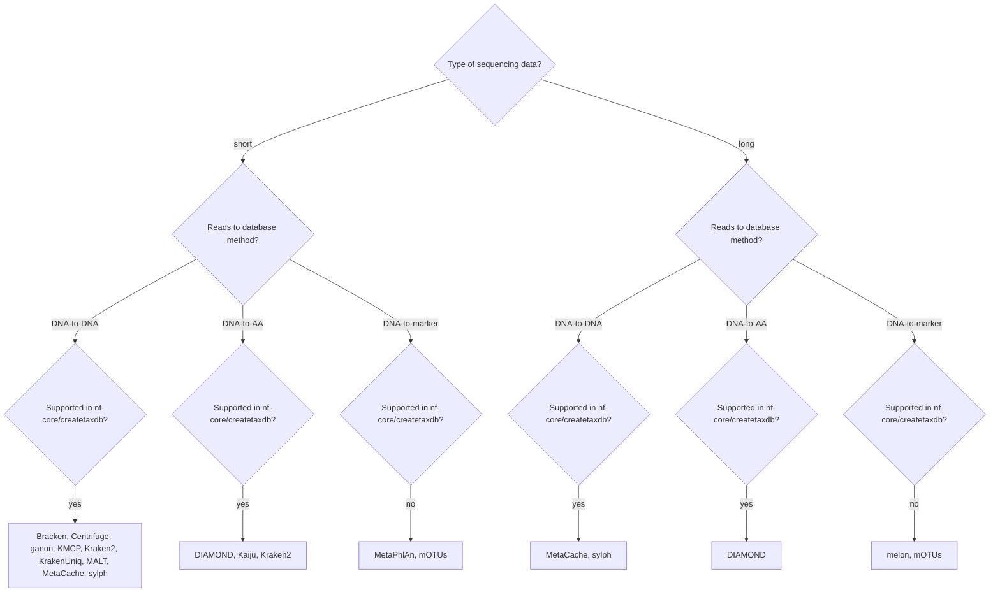

# Troubleshooting and FAQs

## Which classifier(s) should I use?

:::note
Before you dive too deeply into the details of each tool, please be very aware that the most impactful choice is your reference database.
Hence, we provide the companion pipeline [`nf-core/createtaxdb`](https://nf-co.re/createtaxdb) for creating reference databases.
:::

Choosing a classifier is not easy!
There are many pros and cons to each, and the best choice will depend on your research question, the information you need, and the trade-offs needed regarding resources (amongst others).
`nf-core/taxprofiler` is designed to offer multiple classifiers; facilitating easier execution of the one(s) that best suit your needs.

In most cases, you should read the publication of each classifier to understand their trade-offs, in addition to reviewing what other researchers are using in your specific domain.
For example, for more detailed and regularly-updated quantitative comparisons, we highly recommend seeing the latest results of automated benchmarking platforms such as:

- [CAMI challenge](https://www.cami-challenge.org/)
- [LEMMI](https://lemmi.ezlab.org/)

Below we provide a brief summary of some of the characteristics of the classifiers available in `nf-core/taxprofiler`.
With this information we hope to help you make an informed decision on which classifier(s) to use for your particular use case analysis.

:::warning
The guidance here is not definitive, and many of the classifiers can be, and are already, used outside of the applications listed below.
:::

### Decision tree

The decision tree below can help you initially narrow down the classifiers that match your data.
Kraken2 can use both DNA-to-DNA and DNA-to-AA databases, and Bracken follows Kraken2.



### Full details

The table below contains all criteria that we find relevant to compare.

| Classifier | Source research domain \*                         | Supports database customisation? | In createtaxdb? | Sequence read type | Database method\*\*    | Primary classification algorithm                   | Result taxon table contents \*\*\*                                               |
| ---------- | ------------------------------------------------- | -------------------------------- | --------------- | ------------------ | ---------------------- | -------------------------------------------------- | -------------------------------------------------------------------------------- |
| Bracken    | Host-associated microbiome                        | Yes                              | Yes             | Short              | See Kraken2 \*\*\*\*   | See Kraken2 \*\*\*\*                               | See Kraken2 \*\*\*\*                                                             |
| Centrifuge | Microbiome, pathogen, food source                 | Yes                              | Yes             | Short/Long         | DNA-to-DNA             | Seed-and-extend k-mer match                        | Sequence abundance (optionally normalized by genome size)                        |
| DIAMOND    | Host-associated microbiome, environmental DNA     | Yes                              | Yes             | Short/Long         | DNA-to-AA              | Spaced seed-and-extend sequence alignment          | Protein sequence abundance                                                       |
| ganon      | Pathogen, wastewater monitoring                   | Yes                              | Yes             | Short              | DNA-to-DNA             | K-mer match with bloom filter                      | Sequence abundance (optionally taxonomic abundance, with genome size correction) |
| Kaiju      | Host-associated microbiome, environmental DNA     | Yes                              | Yes             | Short              | DNA-to-AA              | Maximum exact match with burrows-wheeler-transform | Protein sequence abundance                                                       |
| KMCP       | Pathogen                                          | Yes                              | Yes             | Short              | DNA-to-DNA             | K-mer with pseudo-mapping and bloom filter         | Taxonomic abundance                                                              |
| Kraken2    | Microbiome, pathogen                              | Yes                              | Yes             | Short              | DNA-to-DNA (DNA-to-AA) | K-mer exact match                                  | Sequence and protein sequence abundance                                          |
| KrakenUniq | Host-associated microbiome, pathogen              | Yes                              | Yes             | Short              | DNA-to-DNA             | K-mer exact match with HyperLogLog counting        | Sequence abundance                                                               |
| MALT       | Host-associated microbiome, pathogen, ancient DNA | Yes                              | Yes             | Short              | DNA-to-DNA             | Spaced seed-and-extend sequence alignment          | Sequence abundance                                                               |
| melon      | Host-associated microbiome, wastewater monitoring | No                               | No              | Long               | DNA-to-marker          | Sequence read-mapper alignment                     | Taxonomic abundance                                                              |
| MetaPhlAn  | Host-associated microbiome                        | Yes                              | No              | Short              | DNA-to-marker          | Sequence read-mapper alignment                     | Taxonomic abundance                                                              |
| MetaCache  | Host-associated microbiome, environmental DNA     | Yes                              | Yes             | Short/Long         | DNA-to-DNA             | Minhashing k-mer match                             | Sequence abundance                                                               |
| mOTUs      | Host-associated microbiome, environmental DNA     | Yes                              | No              | Short/Long         | DNA-to-marker          | Sequence read-mapper alignment                     | Taxonomic abundance                                                              |
| sylph      | Host-associated microbiome                        | Yes                              | Yes             | Short/Long         | DNA-to-DNA             | K-mer sketching                                    | Taxonomic abundance                                                              |

:::note{title=Legend}

\* Source research domain corresponds to the type of research the classifier was applied or referred to within the original publication of the classifier. For example, the benchmarking datasets used to evaluate the classifier, or stated in the potential applications of the tool. It does not preclude the application of the tool in other contexts.

\*\* Reads to database comparison methods are defined as follows:

- **DNA-to-DNA**: DNA sequencing reads against a library of genome-level nucleotide sequences
- **DNA-to-AA**: DNA sequencing reads against a library of genome-level amino-acid (protein) coding sequences
- **DNA-to-marker**: DNA sequencing reads against a library of predefined marker gene or gene families selection

\*\*\* The result taxon table contents are defined as follows:

- **Sequence abundance**: the number of reads assigned to each taxon
- **Protein sequence abundance**: the number of reads assigned to each taxon, based on protein coding sequences
- **Taxonomic abundance**: an estimate of true 'biological' (cellular) abundances of each taxon

\*\*\*\* Bracken is technically not a standalone classifier, but rather a postprocessing tool for Kraken2 output. It does not classify reads itself, but rather re-estimates the abundance of species from Kraken2 results.
:::

Furthermore, the table below provides a summary of the original primary 'unique characteristics' of the particular classifier (as described in the original publication of the classifier).
We order by original publication year as often new-classifier 'improvements' are referring to earlier comparable classifiers; but may not reflect the latest version of the earlier classifier.

| Original publication\* | Latest publication \*\* | Classifier | Unique characteristic                                                                                                                                  |
| ---------------------- | ----------------------- | ---------- | ------------------------------------------------------------------------------------------------------------------------------------------------------ |
| 2012                   | 2023                    | MetaPhlAn  | More accurate and faster species assignment by alignment against unique combinations of clade-marker genes rather than whole genomes                   |
| 2013                   | 2022                    | mOTUs      | More accurate and faster species assignment by alignment against universal phylogenetic marker genes rather than whole genomes                         |
| 2014                   | 2024                    | Kraken2    | Fast and computationally efficient sample assignment against genome-level sequences using k-mers instead of alignment                                  |
| 2015                   | 2021                    | DIAMOND    | Faster than BLASTX due to seeding heuristics                                                                                                           |
| 2016                   |                         | Kaiju      | Higher sensitivity and similar precision than other k-mer based classifiers, particularly for underrepresented genera                                  |
| 2016                   |                         | Centrifuge | Faster and less-memory hungry due to an optimised index file                                                                                           |
| 2016                   |                         | MALT       | Increased sensitivity and specificity over k-mer methods due to ultra-fast seed-and-extend and alignment approach                                      |
| 2017                   |                         | Bracken    | More accurate species and strain abundance estimation over sequence abundance, through weighted reassignment of ambiguously classified reads           |
| 2017                   |                         | MetaCache  | Significantly smaller RAM requirement over comparable k-mer with based tools at similar speed through 'Minhashing' a subset of k-mers                  |
| 2018                   |                         | KrakenUniq | Reduced false-positive identification than Kraken by incorporating k-mer coverage                                                                      |
| 2020                   | 2025                    | ganon2     | Fast, updatable, and small index size, fast classification through optimised index file                                                                |
| 2023                   |                         | KMCP       | Faster and less-memory hungry due to an optimised index file and pseudo-mapping based approach, which offers genome coverage calculation               |
| 2024                   |                         | melon      | Application of previously short-read-only gene marker-based classification approaches but for long-reads, with genome copy level abundance estimations |
| 2024                   |                         | sylph      | Improved accuracy and smaller resource footprint through min-hash sketching of k-mers and average nucleotide identity (ANI) calculations               |

:::note{title=Legend}

\* Original publication: first description of original method or algorithm. Does not necessarily reflect version in the pipeline.
\*\* Latest publication: most recent publication describing updated method or algorithm (e.g. in v2, v3), including updates and improvements
:::

### Other readings

The follow list of publicly accessible or open-access readings may be useful for further understanding of the classifiers and their differences:

- [**Differences between the Kraken family of classifiers**](https://ccb.jhu.edu/software/choosing-a-metagenomics-classifier/): from the Kraken\* authors themselves.
- de Vries, J. J. C., et al. (2021). Recommendations for the introduction of metagenomic next-generation sequencing in clinical virology, part II: bioinformatic analysis and reporting. Journal of Clinical Virology: The Official Publication of the Pan American Society for Clinical Virology, 138(104812), 104812. https://doi.org/10.1016/j.jcv.2021.104812
- de Vries, J. J. C., et al. (2021). Benchmark of thirteen bioinformatic pipelines for metagenomic virus diagnostics using datasets from clinical samples. Journal of Clinical Virology: The Official Publication of the Pan American Society for Clinical Virology, 141(104908), 104908. https://doi.org/10.1016/j.jcv.2021.104908
- Maas, M. A. M., et al. (2026). Use of metagenomics for the detection of pathogens in the environment: A scoping review. Environmental Research, 305(Pt 2), 125050. https://doi.org/10.1016/j.envres.2026.125050
- Meyer, F., et al. (2022). Critical Assessment of Metagenome Interpretation: the second round of challenges. Nature Methods, 19(4), 429–440. [https://doi.org/10.1038/s41592-022-01431-4](https://doi.org/10.1038/s41592-022-01431-4)
- Sczyrba, A., et al.(2017). Critical Assessment of Metagenome Interpretation-a benchmark of metagenomics software. Nature Methods, 14(11), 1063–1071. [https://doi.org/10.1038/nmeth.4458](https://doi.org/10.1038/nmeth.4458)
- Seppey, M., et al. (2026). LEMMIv2: benchmarking framework for metagenomic and 16S amplicon profilers with a catalogue of evaluated tools. Genome Biology, 1–25. [https://doi.org/10.1186/s13059-026-04089-9](https://doi.org/10.1186/s13059-026-04089-9)
- Seppey, M., et al. (2020). LEMMI: a continuous benchmarking platform for metagenomics classifiers. Genome Research, 30(8), 1208–1216. [https://doi.org/10.1101/gr.260398.119](https://doi.org/10.1101/gr.260398.119)
- Ye, S. H., et al. (2019). Benchmarking Metagenomics Tools for Taxonomic Classification. Cell, 178(4), 779–794. [https://doi.org/10.1016/j.cell.2019.07.010](https://doi.org/10.1016/j.cell.2019.07.010)

## I get a warning during CENTRIFUGE_KREPORT or KRAKENTOOLS_COMBINEKREPORTS_CENTRIFUGE process with exit status 255

When a sample has insufficient hits for abundance estimation, the resulting `report.txt` file will be empty.

When trying to convert this to a kraken-style report or merging together, the tools will exit with a status code `255`, and provide a `WARN`.

This is _not_ an error nor a failure of the pipeline, just your sample has no hits to the provided database when using Centrifuge.

## Why does any error or failed process from BRACKEN_BRACKEN get ignored?

If Kraken2 doesn't classify any reads (100% unclassified) Bracken will fail on that input.
Having no reads taxonomically classified can be a reasonable outcome for some samples, and we don't want to treat this as an error.

Therefore to allow the remainder of a given run to complete if a single Bracken task fails, [we set the Nextflow `errorStrategy` to `ignore`](https://github.com/nf-core/taxprofiler/blob/5d3ee5513a84f92773c8376c55b5f4da39835307/conf/base.config#L61-L63).
You will still get a warning in the Nextflow console output and log that a Bracken task failed.

If you want to change this behaviour, you can override the `errorStrategy` in your own Nextflow configuration file.

For example:

```nextflow
process {
    withName: BRACKEN_BRACKEN {
        errorStrategy = 'retry'
    }
}
```

Other `errorStrategy` options can be found on the [Nextflow documentation](https://www.nextflow.io/docs/latest/process.html#errorstrategy).
