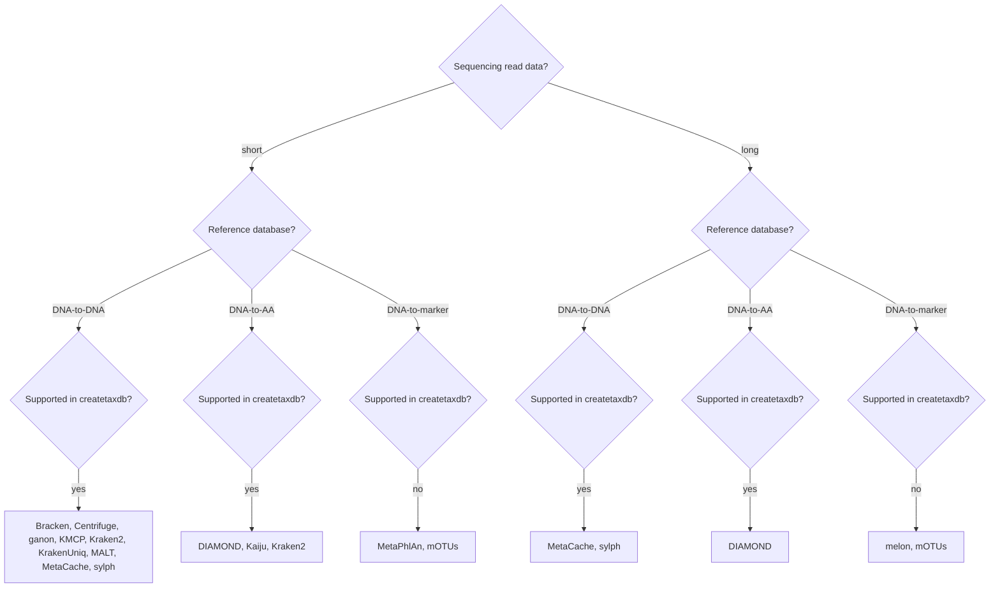

# Troubleshooting and FAQs

## Which classifier(s) should I use?

**Before you dive too deeply into the details of each tool, please be very aware
that the most impactful choice is your reference database. Hence, we provide
the companion pipeline [`nf-core/createtaxdb`](https://nf-co.re/createtaxdb).**

Choosing a classifier is not easy!
There are many pros and cons to each, and the best choice will depend on your research question, the information you need, and the trade-offs needed regarding resources (amongst others).
`nf-core/taxprofiler` is designed to offer multiple classifiers, so you can choose the one(s) that best suit your needs.

Here we provide a brief summary of the classifiers available in `nf-core/taxprofiler`.
With this information we hope to help you make an informed decision on which classifier(s) to use for your particular use case analysis.

Please note that the guidance here is not definitive, and many of the classifiers can be used outside of the applications listed below.

### Decision tree

The decision tree below can help you narrow down the classifiers that match your data.
Kraken2 can use both DNA-to-DNA and DNA-to-AA databases, and Bracken follows Kraken2.



### Full details

The table below contains all criteria that we find relevant to compare.

| Classifier | Sequence read type | Reference database     | Result                                                                           | Primary algorithm | Unique characteristic                                                                                           | Common applications (Sofia)                                   | Source field (James)                              | Supports customisation? | In createtaxdb? |
| ---------- | ------------------ | ---------------------- | -------------------------------------------------------------------------------- | ----------------- | --------------------------------------------------------------------------------------------------------------- | ------------------------------------------------------------- | ------------------------------------------------- | ----------------------- | --------------- |
| Bracken    | short              | See Kraken2            | See Kraken2                                                                      | k-mer\*           | Redistribution of ambiguously classified reads by Kraken2 using a Bayesian model                                | metagenomics/abundance estimation for closely related species | Host-associated microbiome                        | yes                     | yes             |
| Centrifuge | short              | DNA-to-DNA             | Sequence abundance (optionally normalized by genome size)                        | FM-index          | Does not require a lot of RAM compared to other k-mer based classifiers but accuracy depends on the database    | metagenomics, pathogen detection                              | Microbiome, pathogen, food Source                 | yes                     | yes             |
| DIAMOND    | short/long         | DNA-to-AA              | Protein sequence abundance                                                       | alignment based   | High sensitivity and it runs much faster than the traditional BLAST                                             | metagenomics, pathogen detection                              | Host-associated microbiome, environmental DNA     | yes                     | yes             |
| ganon      | short              | DNA-to-DNA             | Sequence abundance (optionally taxonomic abundance, with genome size correction) | k-mer             | Improved genus level F1-score, increased precision, higher compute resource efficient                           | metagenomics                                                  | Pathogen, wastewater monitoring                   | yes                     | yes             |
| Kaiju      | short              | DNA-to-AA              | Protein sequence abundance                                                       | alignment based   | Fast taxonomic classification at the protein level compared to other protein-based taxonomic classifiers        | metagenomics, microbial ecology                               | Host-associated microbiome, environmental DNA     | yes                     | yes             |
| KMCP       | short              | DNA-to-DNA             | Taxonomic abundance                                                              | k-mer             | Reduces the high false-positive rates compared to other k-mer based classifiers                                 | pathogen detection                                            | Pathogen                                          | yes                     | yes             |
| Kraken2    | short              | DNA-to-DNA (DNA-to-AA) | (Protein) sequence abundance                                                     | k-mer             | Ultrafast speed at a minimal memory usage                                                                       | pathogen detection                                            | Microbiome                                        | yes                     | yes             |
| KrakenUniq | short              | DNA-to-DNA             | Sequence abundance                                                               | k-mer             | Reduced false-positive taxonomic classifications but sensitivity can decrease when unclassified reads many      | pathogen detection                                            | Host-associated microbiome, pathogen              | yes                     | yes             |
| MALT       | short              | DNA-to-DNA             | Sequence abundance                                                               | alignment based   | It can provide functional classification along taxonomic classification                                         | ancient metagenomics, microbiome profiling                    | Host-associated microbiome, pathogen, ancient DNA | yes                     | yes             |
| melon      | long               | DNA-to-marker          | Taxonomic abundance                                                              | alignment based   | Outperformed existing tools in vitro mock and in silico simulated samples                                       | microbiome profiling                                          | Host-associated microbiome, wastewater monitoring | no                      | no              |
| MetaPhlAn  | short              | DNA-to-marker          | Taxonomic abundance                                                              | alignment based   | High taxonomic precision                                                                                        | microbiome profiling                                          | Host-associated microbiome                        | yes                     | no              |
| MetaCache  | short/long         | DNA-to-DNA             | Sequence abundance                                                               | k-mer             | Reduced memory requirements                                                                                     | metagenomics, pathogen detection, microbial ecology           | Host-associated microbiome, environmental DNA     | yes                     | yes             |
| mOTUs      | short/long         | DNA-to-marker          | Taxonomic abundance                                                              | alignment based   | High genus-level completeness and strong performance in predicting microbial abundances in genus level          | microbiome profiling                                          | Host-associated microbiome, environmental DNA     | yes                     | no              |
| sylph      | short/long         | DNA-to-DNA             | Taxonomic abundance                                                              | k-mer             | High-species level profiling with rapid processing time, comparable to marker gene methods at the species level | metagenomics, pathogen detection                              | Host-associated microbiome                        | yes                     | yes             |

\* Bracken is technically not a standalone classifier, but rather a postprocessing tool for Kraken2 output. It does not classify reads itself, but rather re-estimates the abundance of species from Kraken2 results.

## I get a warning during CENTRIFUGE_KREPORT or KRAKENTOOLS_COMBINEKREPORTS_CENTRIFUGE process with exit status 255

When a sample has insufficient hits for abundance estimation, the resulting `report.txt` file will be empty.

When trying to convert this to a kraken-style report or merging together, the tools will exit with a status code `255`, and provide a `WARN`.

This is _not_ an error nor a failure of the pipeline, just your sample has no hits to the provided database when using Centrifuge.

## Why does any error or failed process from BRACKEN_BRACKEN get ignored?

If Kraken2 doesn't classify any reads (100% unclassified) Bracken will fail on that input.
Having no reads taxonomically classified can be a reasonable outcome for some samples, and we don't want to treat this as an error.

Therefore to allow the remainder of a given run to complete if a single Bracken task fails, [we set the Nextflow `errorStrategy` to `ignore`](https://github.com/nf-core/taxprofiler/blob/5d3ee5513a84f92773c8376c55b5f4da39835307/conf/base.config#L61-L63).
You will still get a warning in the Nextflow console output and log that a Bracken task failed.

If you want to change this behaviour, you can override the `errorStrategy` in your own Nextflow configuration file.

For example:

```nextflow
process {
    withName: BRACKEN_BRACKEN {
        errorStrategy = 'retry'
    }
}
```

Other `errorStrategy` options can be found on the [Nextflow documentation](https://www.nextflow.io/docs/latest/process.html#errorstrategy).
