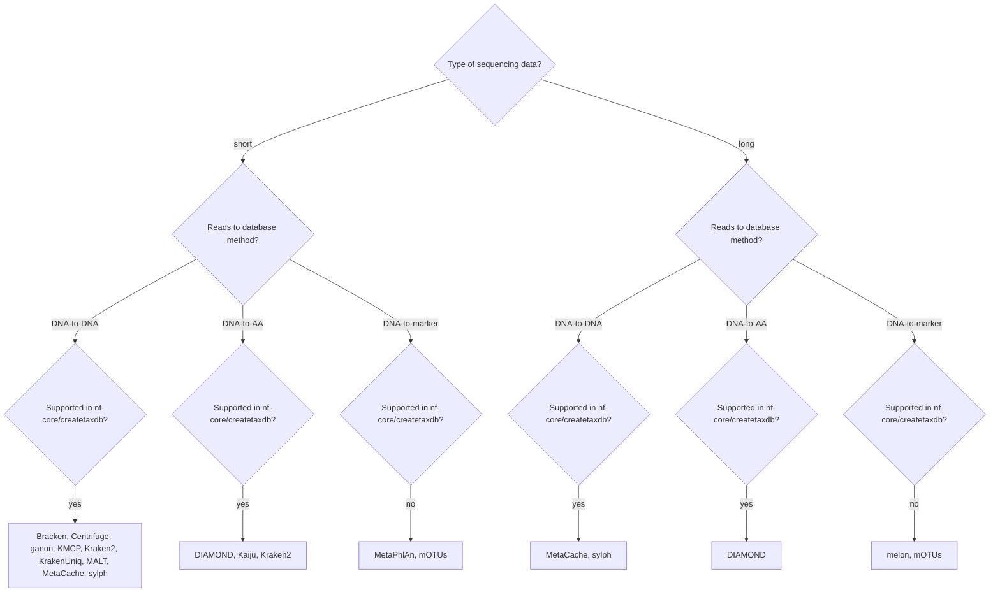

# Troubleshooting and FAQs

## Which classifier(s) should I use?

:::note
Before you dive too deeply into the details of each tool, please be very aware that the most impactful choice is your reference database.
Hence, we provide the companion pipeline [`nf-core/createtaxdb`](https://nf-co.re/createtaxdb) for creating reference databases.
:::

Choosing a classifier is not easy!
There are many pros and cons to each, and the best choice will depend on your research question, the information you need, and the trade-offs needed regarding resources (amongst others).
`nf-core/taxprofiler` is designed to offer multiple classifiers; facilitating easier execution of the one(s) that best suit your needs.

In most cases, you should read the publication of each classifier to understand their trade-offs, in addition to reviewing to what other researchers are using in your specific domain.
For example, for more detailed and regularly-updated quantitative comparisons, we highly recommend seeing the latest results of automated benchmarking platforms such as:

- [CAMI challenge](https://www.cami-challenge.org/)
- [LEMMI](https://lemmi.ezlab.org/)

Below we provide a brief summary of some of the characteristics of the classifiers available in `nf-core/taxprofiler`.
With this information we hope to help you make an informed decision on which classifier(s) to use for your particular use case analysis.

:::warning
The guidance here is not definitive, and many of the classifiers can be used outside of the applications listed below.
:::

### Decision tree

The decision tree below can help you initially narrow down the classifiers that match your data.
Kraken2 can use both DNA-to-DNA and DNA-to-AA databases, and Bracken follows Kraken2.



### Full details

The table below contains all criteria that we find relevant to compare.

| Classifier | Source research domain \*                         | Supports database customisation? | In createtaxdb? | Sequence read type | Database method\*\*    | Primary classification algorithm                   | Result taxon table contents \*\*                                                 | Unique characteristic                                                                                           |
| ---------- | ------------------------------------------------- | -------------------------------- | --------------- | ------------------ | ---------------------- | -------------------------------------------------- | -------------------------------------------------------------------------------- | --------------------------------------------------------------------------------------------------------------- |
| Bracken    | Host-associated microbiome                        | Yes                              | Yes             | Short              | See Kraken2            | See Kraken2 \*\*\*                                 | See Kraken2 \*\*\*                                                               | Redistribution of ambiguously classified reads by Kraken2 using a Bayesian model                                |
| Centrifuge | Microbiome, pathogen, food source                 | Yes                              | Yes             | Short/Long         | DNA-to-DNA             | Seed-and-extend k-mer match                        | Sequence abundance (optionally normalized by genome size)                        | Does not require a lot of RAM compared to other k-mer based classifiers but accuracy depends on the database    |
| DIAMOND    | Host-associated microbiome, environmental DNA     | Yes                              | Yes             | Short/Long         | DNA-to-AA              | Spaced seed-and-extend sequence alignment          | Protein sequence abundance                                                       | High sensitivity and it runs much faster than the traditional BLAST                                             |
| ganon      | Pathogen, wastewater monitoring                   | Yes                              | Yes             | Short              | DNA-to-DNA             | K-mer match with bloom filter                      | Sequence abundance (optionally taxonomic abundance, with genome size correction) | Improved genus level F1-score, increased precision, higher compute resource efficient                           |
| Kaiju      | Host-associated microbiome, environmental DNA     | Yes                              | Yes             | Short              | DNA-to-AA              | Maximum exact match with burrows-wheeler-transform | Protein sequence abundance                                                       | Fast taxonomic classification at the protein level compared to other protein-based taxonomic classifiers        |
| KMCP       | Pathogen                                          | Yes                              | Yes             | Short              | DNA-to-DNA             | K-mer with pseudo-mapping and bloom filter         | Taxonomic abundance                                                              | Reduces the high false-positive rates compared to other k-mer based classifiers                                 |
| Kraken2    | Microbiome                                        | Yes                              | Yes             | Short              | DNA-to-DNA (DNA-to-AA) | K-mer exact match                                  | (Protein) sequence abundance                                                     | Ultrafast speed at a minimal memory usage                                                                       |
| KrakenUniq | Host-associated microbiome, pathogen              | Yes                              | Yes             | Short              | DNA-to-DNA             | K-mer exact match with HyperLogLog counting        | Sequence abundance                                                               | Reduced false-positive taxonomic classifications but sensitivity can decrease when unclassified reads many      |
| MALT       | Host-associated microbiome, pathogen, ancient DNA | Yes                              | Yes             | Short              | DNA-to-DNA             | Spaced seed-and-extend sequence alignment          | Sequence abundance                                                               | It can provide functional classification along taxonomic classification                                         |
| melon      | Host-associated microbiome, wastewater monitoring | No                               | No              | Long               | DNA-to-marker          | Sequence read-mapper alignment                     | Taxonomic abundance                                                              | Outperformed existing tools in vitro mock and in silico simulated samples                                       |
| MetaPhlAn  | Host-associated microbiome                        | Yes                              | No              | Short              | DNA-to-marker          | Sequence read-mapper alignment                     | Taxonomic abundance                                                              | High taxonomic precision                                                                                        |
| MetaCache  | Host-associated microbiome, environmental DNA     | Yes                              | Yes             | Short/Long         | DNA-to-DNA             | Min-hashing k-mer match                            | Sequence abundance                                                               | Reduced memory requirements                                                                                     |
| mOTUs      | Host-associated microbiome, environmental DNA     | Yes                              | No              | Short/Long         | DNA-to-marker          | Sequence read-mapper alignment                     | Taxonomic abundance                                                              | High genus-level completeness and strong performance in predicting microbial abundances in genus level          |
| sylph      | Host-associated microbiome                        | Yes                              | Yes             | Short/Long         | DNA-to-DNA             | K-mer sketching                                    | Taxonomic abundance                                                              | High-species level profiling with rapid processing time, comparable to marker gene methods at the species level |

:::note{title=Legend}

\* Source research domain corresponds to the research the classifier was applied to within the original publication of the classifier, for example the benchmarking datasets used to evaluate the classifier.

\*\* Reads to database comparison methods are defined as follows:

- **DNA-to-DNA**: DNA sequencing reads against a library of genome-level nucleotide sequences
- **DNA-to-AA**: DNA sequencing reads against a library of genome-level amino-acid (protein) coding sequences
- **DNA-to-marker**: DNA sequencing reads against a library of pre-defined marker gene or gene families selection

\*\* The result taxon table contents are defined as follows:

- **Sequence abundance**: the number of reads assigned to each taxon
- **Protein sequence abundance**: the number of reads assigned to each taxon, based on protein coding
- **Taxonomic abundance**: an estimate of true 'biological' (cellular) abundances of each taxon

\*\*\* Bracken is technically not a standalone classifier, but rather a postprocessing tool for Kraken2 output. It does not classify reads itself, but rather re-estimates the abundance of species from Kraken2 results.
:::

Furthermore, the table below provides a summary of the primary 'unique characteristics' of the particular classifier (as described in the original publication of the classifier).
We order by original publication year as often new-classifier 'improvements' are referring to earlier comparable classifiers; but may not reflect the latest version of the earlier classifier.

<!-- TODO -->

| Original publication\* | Latest publication \*\* | Classifier | Unique characteristic                                                                                                                 |
| ---------------------- | ----------------------- | ---------- | ------------------------------------------------------------------------------------------------------------------------------------- |
| 2012                   | 2023                    | MetaPhlAn  |                                                                                                                                       |
| 2013                   | 2022                    | mOTUs      |                                                                                                                                       |
| 2014                   | 2024                    | Kraken2    | Fast and memory efficient using k-mers instead of alignment                                                                           |
| 2015                   | 2021                    | DIAMOND    | Faster than BLASTX due to seeding heuristics                                                                                          |
| 2016                   |                         | Kaiju      | Higher sensitivity and similar precision than other k-mer based classifiers, particularly for unrepresented genera                    |
| 2016                   |                         | Centrifuge | Faster and less-memory hungry due to optimised index file                                                                             |
| 2016                   |                         | MALT       |                                                                                                                                       |
| 2017                   |                         | Bracken    |                                                                                                                                       |
| 2017                   |                         | MetaCache  |                                                                                                                                       |
| 2018                   |                         | KrakenUniq | Reduced false-positive identification than Kraken by incorporating k-mer coverage                                                     |
| 2020                   | 2025                    | ganon2     | Fast, updatable, and small index size, fast classification                                                                            |
| 2023                   |                         | KMCP       | Faster and less-memory hungry due to optimised index file and pseudo-mapping based approach, which offers genome coverage calculation |
| 2024                   |                         | melon      |                                                                                                                                       |
| 2024                   |                         | sylph      |                                                                                                                                       |

<!--
Sofia's original table - to incorporate into above table when verified:

| Classifier |  Unique characteristic                                                                                           |
| ---------- |  --------------------------------------------------------------------------------------------------------------- |
| Bracken    |  Redistribution of ambiguously classified reads by Kraken2 using a Bayesian model                                |
| Centrifuge |  Does not require a lot of RAM compared to other k-mer based classifiers but accuracy depends on the database    |
| DIAMOND    |  High sensitivity and it runs much faster than the traditional BLAST                                             |
| ganon      |  Improved genus level F1-score, increased precision, higher compute resource efficient                           |
| Kaiju      |  Fast taxonomic classification at the protein level compared to other protein-based taxonomic classifiers        |
| KMCP       |  Reduces the high false-positive rates compared to other k-mer based classifiers                                 |
| Kraken2    |  Ultrafast speed at a minimal memory usage                                                                       |
| KrakenUniq |  Reduced false-positive taxonomic classifications but sensitivity can decrease when unclassified reads many      |
| MALT       |  It can provide functional classification along taxonomic classification                                         |
| melon      |  Outperformed existing tools in vitro mock and in silico simulated samples                                       |
| MetaPhlAn  |  High taxonomic precision                                                                                        |
| MetaCache  |  Reduced memory requirements                                                                                     |
| mOTUs      |  High genus-level completeness and strong performance in predicting microbial abundances in genus level          |
| sylph      |  High-species level profiling with rapid processing time, comparable to marker gene methods at the species level |
-->

:::note{title=Legend}

\* Original publication: first description of original method or algorithm. Does not necessarily reflect version in the pipeline.
\*\* Latest publication: most recent publication describing updated method or algorithm (e.g. in v2, v3), including updates and improvements
:::

## I get a warning during CENTRIFUGE_KREPORT or KRAKENTOOLS_COMBINEKREPORTS_CENTRIFUGE process with exit status 255

When a sample has insufficient hits for abundance estimation, the resulting `report.txt` file will be empty.

When trying to convert this to a kraken-style report or merging together, the tools will exit with a status code `255`, and provide a `WARN`.

This is _not_ an error nor a failure of the pipeline, just your sample has no hits to the provided database when using Centrifuge.

## Why does any error or failed process from BRACKEN_BRACKEN get ignored?

If Kraken2 doesn't classify any reads (100% unclassified) Bracken will fail on that input.
Having no reads taxonomically classified can be a reasonable outcome for some samples, and we don't want to treat this as an error.

Therefore to allow the remainder of a given run to complete if a single Bracken task fails, [we set the Nextflow `errorStrategy` to `ignore`](https://github.com/nf-core/taxprofiler/blob/5d3ee5513a84f92773c8376c55b5f4da39835307/conf/base.config#L61-L63).
You will still get a warning in the Nextflow console output and log that a Bracken task failed.

If you want to change this behaviour, you can override the `errorStrategy` in your own Nextflow configuration file.

For example:

```nextflow
process {
    withName: BRACKEN_BRACKEN {
        errorStrategy = 'retry'
    }
}
```

Other `errorStrategy` options can be found on the [Nextflow documentation](https://www.nextflow.io/docs/latest/process.html#errorstrategy).
